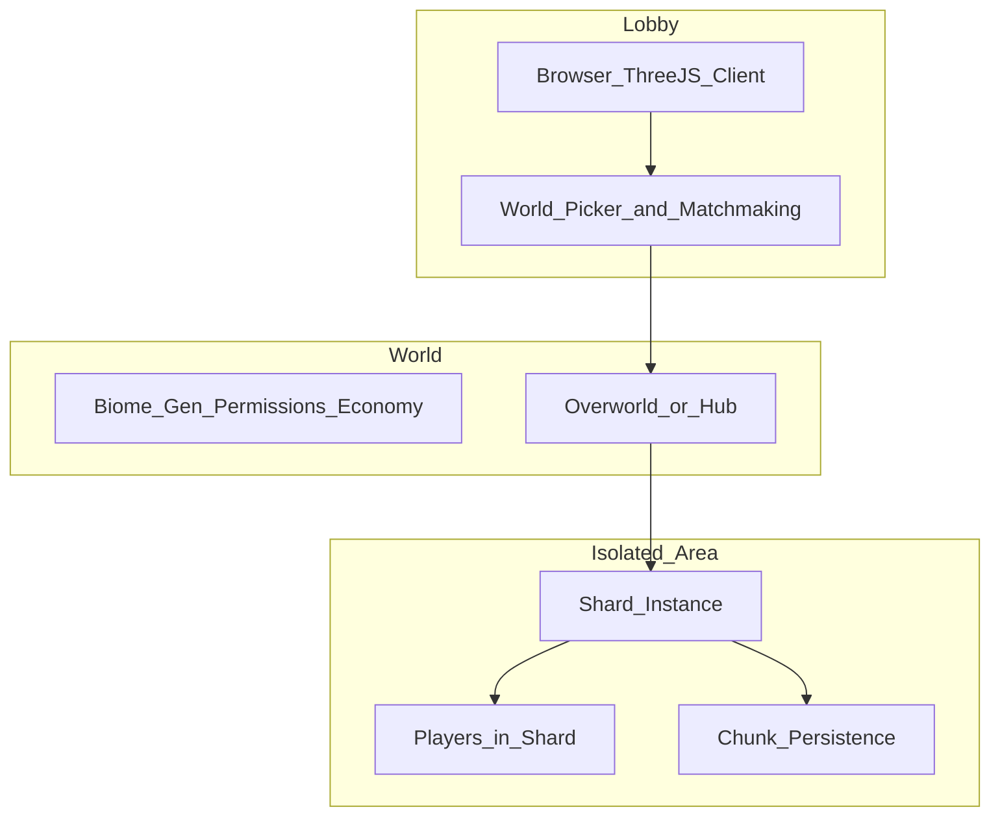

# Web Voxel Multi-World Platform — Build Plan

> Product and technical directions for a browser-based voxel platform: many joinable worlds, each subdivided into huge but isolated play spaces, plus a path to prototype in this repo.

## Open items

- [ ] Choose north star: creative hosting, session arcade, exploration MMO-lite, or creator platform
- [ ] Spec MVP: one world, public + invite shards, place/break, shard browser, optional portal
- [ ] Sketch gateway + shard worker + chunk store and procedural+delta persistence model
- [ ] Plan Three.js client: workers for meshing, WebSocket binary protocol, LOD for web/mobile

## Core mental model

The pitch maps cleanly to a **three-layer hierarchy**:

- **World**: shared identity—lore, block palette, gravity, day/night, whether PvP is on, seed or procedural rules.
- **Isolated area (shard)**: same world rules, but **separate simulation + storage** (only people in that shard see each other’s edits and avatars). “Massive” here usually means **large coordinate space or procedural infinite terrain**, not one giant single-server simulation.
- **Web advantage**: one URL → instant play; easy **spectate**, **embed**, and **invite links** with world + shard + coordinates in the query string.

---

## Experience ideas (what players actually do)

### Exploration and discovery

| Idea | Hook |
|------|------|
| **Planet belt** | Each “world” is a planet with different voxel density, caves, floating islands, or inverted gravity. Shards are continents or orbital stations. |
| **Archipelago matchmaking** | Overworld is only portals; every island shard is procedurally rolled (biome mix, ruins, dungeons) when the first player enters. |
| **Cartographer mode** | Exploring reveals the map for everyone in the shard; rare blocks unlock journal entries or world lore. |
| **Seasonal worlds** | Worlds wipe or mutate on a schedule (meteor week, flood season); old shards become read-only “ghost” archives to visit. |

### Building and creativity

| Idea | Hook |
|------|------|
| **Shard = plot** | Join a shard to get a huge build volume; friends get build permissions; strangers visit read-only or by invite token. |
| **Collaborative megastructures** | One shard = one community project (ring city, voxel cathedral) with contribution leaderboard and timelapse replay. |
| **Template shards** | Official starter shards (medieval village skeleton, space station frame) that teams extend. |
| **Export and embed** | Publish a frozen snapshot as a WebGL viewer page others can orbit without joining live sim. |

### Social and lightweight games

| Idea | Hook |
|------|------|
| **Parkour circuits** | Shards optimized for movement (ice, bounce pads); ghosts of best runs; share `?shard=parkour-7&seed=…` links. |
| **Hide and seek / prop hunt** | Small instanced shards, short sessions, no persistence pressure. |
| **Territory paint** | Two teams claim voxels with color; shard resets every 20 minutes. |
| **Concert / event shards** | Audio-reactive shaders; voxel stage; capacity-limited instance for performances. |

### Adventure and progression (still voxel-native)

| Idea | Hook |
|------|------|
| **Dungeon instances** | Party opens a shard keyed to seed + difficulty; layout procedural; loot account-bound, terrain discarded after. |
| **Resource worlds vs home shards** | Dangerous public resource shards; safe private home shard linked by one-way portals (items allowed or cosmetic only). |
| **Quest hotspots** | Hand-authored POIs sprinkled in procedural shards; server validates “found the obelisk” without trusting client. |
| **Boss arenas** | Single-purpose shards with destructible terrain mechanics (break floor phases). |

### Education, art, and weird

| Idea | Hook |
|------|------|
| **Museum worlds** | Voxel replicas of architectures; guided tour paths; annotations on blocks. |
| **Math / CS visualizers** | Worlds that render fractals, cellular automata, or sorting algorithms as placeable structures. |
| **AI guide NPCs** | Web-friendly: LLM gives hints in-world; voxel signs generated from prompts (moderated). |
| **Slow world** | Shard time runs 1× real day = 1 in-game week; encourages long-term communal farms. |

---

## Differentiators worth leaning into (web + shards)

1. **Link as save file** — `world=ember&shard=abc123&x=&y=&z=` drops friends at the exact place; great for Twitch/Discord culture.
2. **Spectator tabs** — watch a shard without avatar; lower bandwidth than full participation.
3. **Cross-shard portals** — same world skin, different instance IDs; feels like one universe without one overloaded server.
4. **Progressive quality** — mobile joins as low LOD + limited build radius; desktop gets full view distance.
5. **User-generated worlds** — creators upload generator params (not gigabyte maps); platform spins shards on demand.

---

## Technical shape (so ideas stay feasible)

High-level split that matches “many worlds, massive isolated areas”:

| Layer | Responsibility |
|-------|----------------|
| **Gateway** | Auth, world list, assign/rejoin shard, WebSocket endpoint |
| **Shard worker** | Simulation for one shard ID: block deltas, entities, interest management |
| **Chunk store** | Column/chunk blobs keyed by `(worldId, shardId, chunkX, chunkZ)` |
| **Asset CDN** | Block textures, sounds; client bundles Three.js + mesher (greedy / ambient occlusion) |

**Sharding strategies** (pick per world type):

- **Private shard per group** — UUID when party forms; ideal for build plots and dungeons.
- **Public shard pool** — match players into shards under population cap; new shard when full.
- **Spatial sharding** — rare at true voxel edit scale unless edits are sparse; easier if “isolated areas” are **discrete instances** not arbitrary borders in one map.

**Massive space without massive RAM**: procedural generation from `(worldSeed, shardSalt, chunkCoord)` + only persist **deltas** (player changes). Infinite terrain becomes believable.

Client: Three.js or raw WebGL2, shared-array-buffer or worker-based meshing, binary block updates over WebSocket.

---

## Product lanes (choose a north star)

These are **different games** built on the same platform:

1. **Creative hosting** — Plot/shard rentals, permissions, embeds (closest to “voxel Realms in the browser”).
2. **Session arcade** — Short match shards, low persistence, high variety (parkour, party games).
3. **Exploration MMO-lite** — Few hand-crafted worlds, many procedural shards, light progression and trading.
4. **Creator platform** — Users define world JSON (blocks, gravity, generators); you host instances.

You can launch one lane and keep the others as world templates later.

---

## Suggested first vertical slice for Voxel_Planet

Minimal proof that sells the vision in a browser:

1. **One world** (“Genesis”) with flat or simple noise terrain.
2. **Two shard types**: (a) public shard with player cap 16, (b) invite-only shard via code in URL.
3. **Block place/break** with server authority; chunks meshed on client.
4. **Portal block or UI** to hop shards while staying in the same world theme.
5. **Spectator count** on shard browser screen.

That demonstrates worlds → isolated areas → multiplayer without committing to RPG, economy, or infinite planets on day one.

---

## Risks to plan for early

- **Cheating** — all placement/removal validated server-side; client is untrusted.
- **Moderation** — report shard, kick/ban, optional keyword filter on signs.
- **Cost** — idle empty shards should sleep or TTL; persist only active or subscribed shards.
- **Bandwidth** — interest management (only send nearby chunk diffs); consider chunk versioning.

---

## Optional stretch goals (after slice)

- Account profiles and cross-shard cosmetics only (no pay-to-win block types).
- Marketplace for world generator plugins (sandboxed WASM on server).
- Voice proximity via existing WebRTC SFU (shard = voice room).
- Replays: record block delta stream for timelapse.